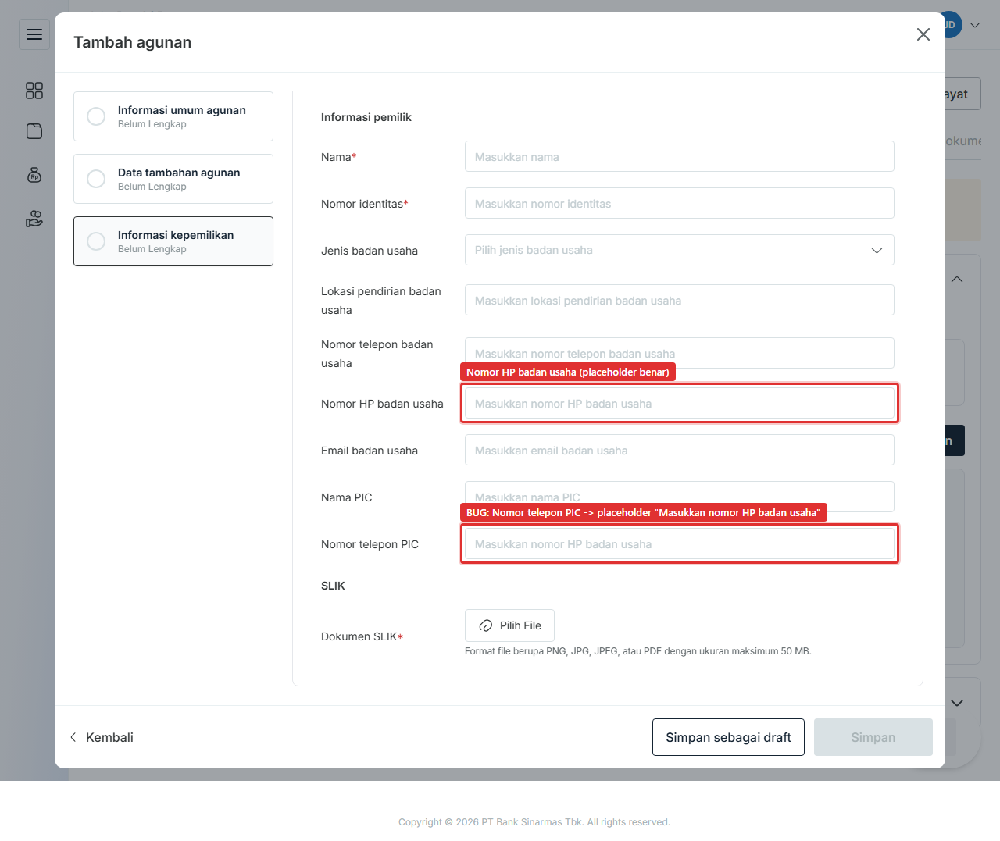
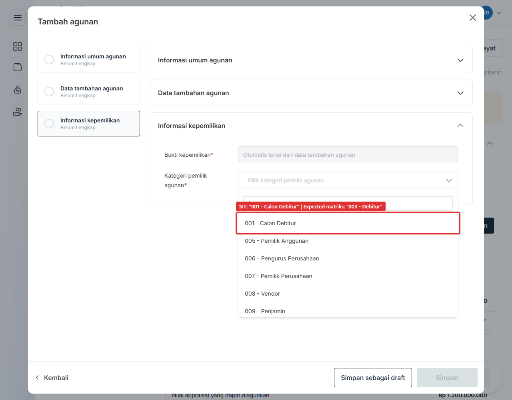
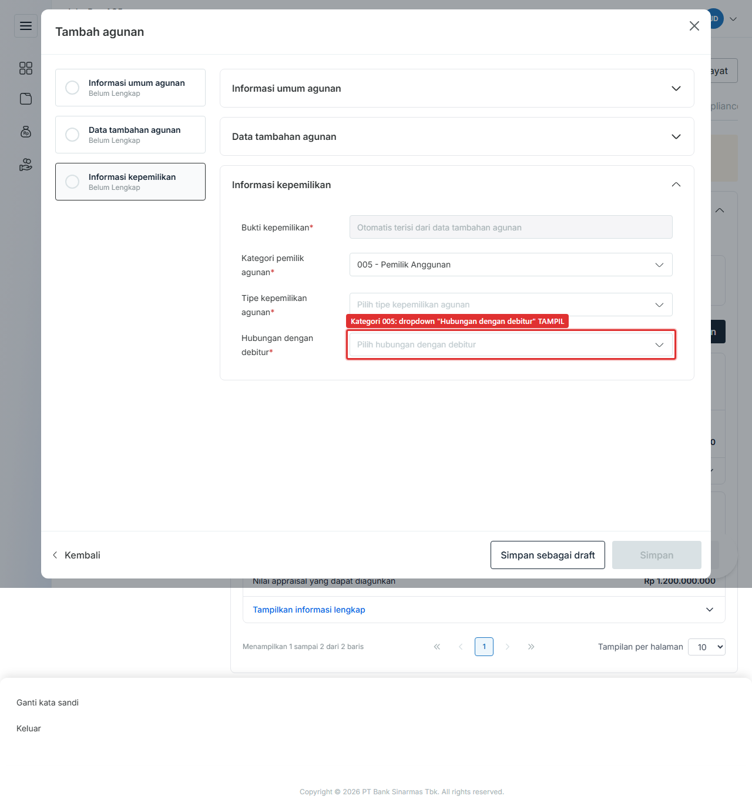
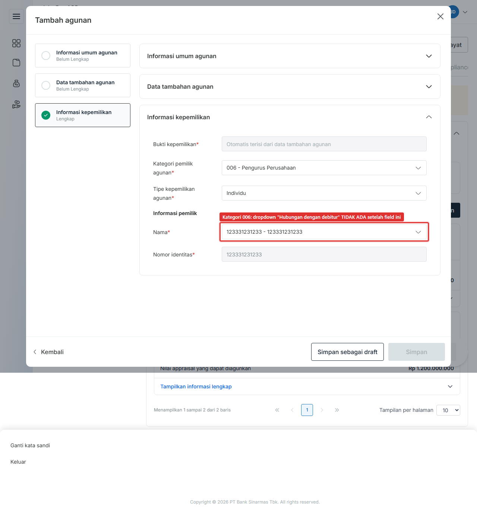
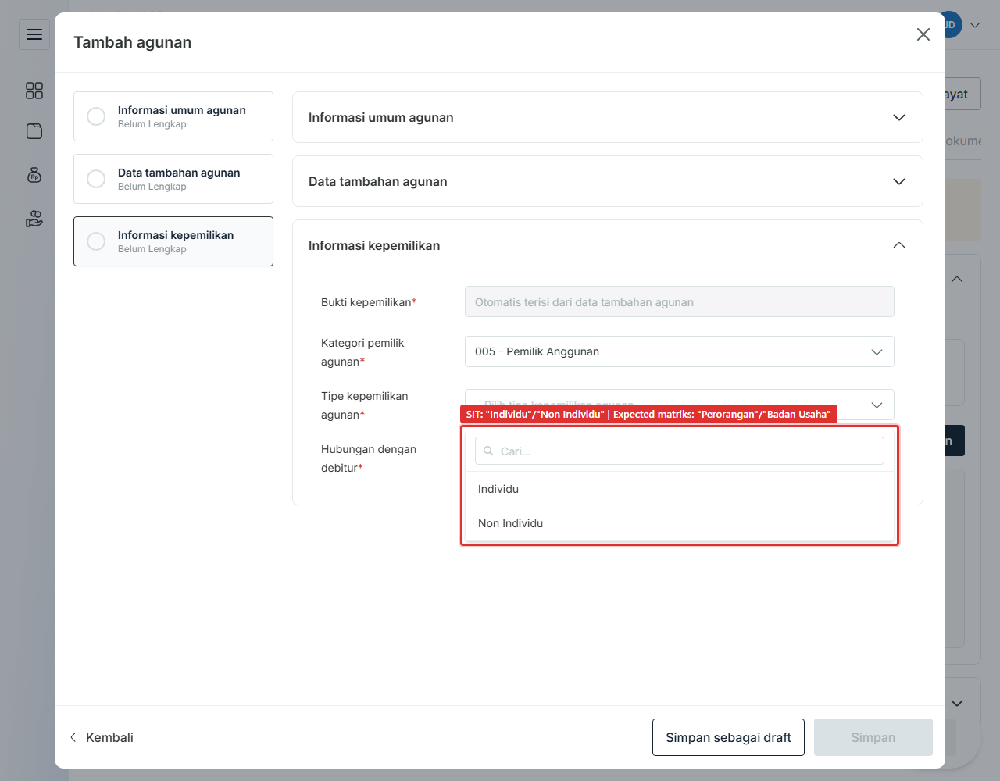

# Laporan Bug & Mismatch Desain — Bucket Agunan (Step 3: Informasi Kepemilikan)

**Tanggal pengujian:** 1 November 2026
**Environment:** LAMOS Core Loan SIT — `https://los-fe-coreloan-sit.devs.banksinarmas.com/`
**Story terkait:** S2CML-4948, S2CML-4949, S2CML-4890
**Application ID yang diuji:**
- Perorangan: `01M4F7TNSCSHEDB5G3WTSP7HDY` (`debtorType=individual`)
- Badan Usaha: `01M482PRSVH5ZMTVZX5QH0VDNZ` (`debtorType=business`)

**Cara reproduksi eviden:**
```bash
npx playwright test tests/bucketAgunan/_umum/eviden-bug-report.spec.ts --project=chromium
```
Seluruh screenshot di bawah dihasilkan otomatis oleh suite tersebut (4 passed, 1.8m) dan tersimpan di `explore-output/bug/`.

---

## Ringkasan

| No | Layer | Judul | Score | Parent Story |
|---|---|---|---|---|
| BUG-01 | **FE** | Placeholder field "Nomor telepon PIC" salah (duplikasi field lain) | 1 | S2CML-4949 |
| MISMATCH-01 | **BE** | Dropdown `ownerCategory` mengirim `001`, bukan `003`, pada debitur Badan Usaha | 3 | S2CML-4948 |
| MISMATCH-02 | **BE** | Opsi "Hubungan dengan debitur" tidak tersedia pada kategori `006` | 2 | S2CML-4948 |
| MISMATCH-03 | **BE** | Tipe Kepemilikan Agunan memakai master data `JENIS_DEBITUR` | 3 | S2CML-4949 |

### Cara layer ditentukan

Seluruh response API ditangkap selama interaksi, lalu dibandingkan dengan apa yang dirender FE:
- **BE mengirim data, FE tidak menampilkan** → defect FE
- **BE tidak mengirim data sama sekali** → defect BE

Spec penelusuran: `tests/bucketAgunan/_umum/explore-fe-vs-be.spec.ts` dan `tests/bucketAgunan/_umum/explore-placeholder-source.spec.ts`.

> **Koreksi atas versi awal laporan ini**: ketiga MISMATCH semula ditulis sebagai "mungkin matriks yang perlu diperbarui". Setelah diverifikasi ke **Acceptance Criteria Jira** (bukan hanya matriks test case), ketiganya bertentangan dengan AC — jadi ketiganya adalah defect yang sah. Lihat kutipan AC pada tiap bagian di bawah.

---

## BUG-01 — [FE] Placeholder field "Nomor telepon PIC" tertulis "Masukkan nomor HP badan usaha"

**Layer:** Frontend
**Defect Score:** 1 (kosmetik, tidak memblokir alur)
**Parent story:** S2CML-4949
**Modul:** Step 3 → Informasi kepemilikan → Form SLIK tipe Non Individu

### Langkah reproduksi
1. Buka modal **Tambah agunan** pada debitur perorangan `01M4F7TNSCSHEDB5G3WTSP7HDY`.
2. Masuk ke Step 3 **Informasi kepemilikan**.
3. Pilih Kategori pemilik agunan = **005 - Pemilik Anggunan**.
4. Pilih Tipe kepemilikan agunan = **Non Individu**.
5. Gulir ke bawah hingga field **Nomor telepon PIC**.

### Expected
Placeholder field "Nomor telepon PIC" berbunyi `Masukkan nomor telepon PIC`.

### Actual
Placeholder berbunyi `Masukkan nomor HP badan usaha` — identik dengan placeholder field **Nomor HP badan usaha** yang berada 3 baris di atasnya.

### Eviden


Kedua field tertandai kotak merah agar duplikasinya terlihat berdampingan.

### Data pendukung
Urutan placeholder yang terbaca dari DOM (`input:visible`):
```json
["Otomatis terisi dari data tambahan agunan","Masukkan nama","Masukkan nomor identitas",
 "Masukkan lokasi pendirian badan usaha","Masukkan nomor telepon badan usaha",
 "Masukkan nomor HP badan usaha","Masukkan email badan usaha","Masukkan nama PIC",
 "Masukkan nomor HP badan usaha"]
```
Entri terakhir adalah field Nomor telepon PIC.

### Layer penyebab: FRONTEND
Nol response API memuat string placeholder tersebut — string-nya hardcode di bundle FE `/_next/static/chunks/5970-28b82b8013712c73.js`:

```js
{id:"ownership-pic-phone", name:"ownership.picPhoneNumber", label:"Nomor telepon PIC",
 labelPosition:"left", placeholder:"Masukkan nomor HP badan usaha", isPhoneNumber:!0}
```

Field name dan label sudah benar — hanya nilai `placeholder` yang ter-copy dari field di atasnya. Perbaikan cukup satu string di komponen form, tanpa perubahan BE.

### Dampak
Pengguna dapat salah mengisi nomor HP badan usaha ke kolom PIC. Tidak memblokir penyimpanan karena field ini opsional (tanpa tanda `*`).

---

## MISMATCH-01 — [BE] Dropdown `ownerCategory` mengirim `001`, bukan `003`

**Layer:** Backend
**Defect Score:** 3
**Parent story:** S2CML-4948
**TC terkait:** `TC-4948-04`, `TC-4948-13`, `TC-4890-BU-02`

### Langkah reproduksi
1. Buka modal **Tambah agunan** pada debitur badan usaha `01M482PRSVH5ZMTVZX5QH0VDNZ`.
2. Masuk ke Step 3 **Informasi kepemilikan**.
3. Buka dropdown **Kategori pemilik agunan**.

### Expected (per AC S2CML-4948, tabel "Map Pilihan Dropdown")
> `003 - Debitur` — Munculkan apabila Debitur **sudah** memiliki Fasilitas aktif di Bank Sinarmas pada saat pengajuan, dilihat dari Struktur Kredit - part Exposure

### Actual
Dropdown memuat **`001 - Calon Debitur`**; opsi `003` sama sekali tidak muncul. Daftar lengkap:
```json
["001 - Calon Debitur","005 - Pemilik Anggunan","006 - Pengurus Perusahaan",
 "007 - Pemilik Perusahaan","008 - Vendor","009 - Penjamin","010 - Pasangan Penjamin"]
```

### Layer penyebab: BACKEND
BE sendiri yang mengirim `001` dan tidak mengirim `003` — FE hanya merender apa yang diterima:

```
GET /lossvc/v1/sme/loans/01M482PRSVH5ZMTVZX5QH0VDNZ/dropdowns?type=ownerCategory

[200] {"data":[{"code":"001","name":"Calon Debitur"},{"code":"005","name":"Pemilik Anggunan"},
 {"code":"006","name":"Pengurus Perusahaan"},{"code":"007","name":"Pemilik Perusahaan"},
 {"code":"008","name":"Vendor"},{"code":"009","name":"Penjamin"},
 {"code":"010","name":"Pasangan Penjamin"}]}
```

### Eviden


### Catatan untuk BA
AC menulis *"BE will always give FE all dropdown, need case if FE cannot handle logic to disable based on logic"* — namun BE justru sudah memfilter daftarnya, dan hasil filter untuk debitur ini tidak memuat `003`.

Mohon dicek: apakah status Exposure pada App ID ini memang kosong (sehingga `001` benar), atau logika pemetaan `003` di BE yang belum berjalan? Auto-fill sendiri berjalan normal — nama badan usaha `PT Bintang Sejahtera` dan nomor legalitas `3578241603710991` terisi otomatis dan read-only.

---

## MISMATCH-02 — [BE] Opsi "Hubungan dengan debitur" tidak tersedia pada kategori `006`

**Layer:** Backend
**Defect Score:** 2
**Parent story:** S2CML-4948
**TC terkait:** `TC-4948-16`

### Langkah reproduksi
1. Buka modal **Tambah agunan** pada debitur badan usaha `01M482PRSVH5ZMTVZX5QH0VDNZ`.
2. Masuk ke Step 3 **Informasi kepemilikan**.
3. Pilih Kategori pemilik agunan = **006 - Pengurus Perusahaan**.
4. Pilih salah satu nama pengurus dari dropdown **Nama**.
5. Amati daftar field yang dirender.

### Expected (per AC S2CML-4948)
Bagian *"Triggering Kategori Kepemilikan Agunan Pada saat dipilih adalah Pengurus Perusahaan, atau Pemilik Perusahaan"* menyatakan:

```
- Tipe Kepimilikan Agunan (Perorangan/Badan Usaha) - sesuai Tipe organ badan usaha
- Hubungan dengan Debitur : Show All Dropdown, Need Choose One Based on Dropdown
- Hubungan dengan Debitur (McKinsey) : Perusahaan
- Status Kepemilikan : Kepemilikan Bersama
```

**Penting:** `Hubungan dengan Debitur` dan `Hubungan dengan Debitur (McKinsey)` adalah **dua field berbeda**. Yang di-set otomatis ke `Perusahaan` adalah field McKinsey (internal BE); dropdown `Hubungan dengan Debitur` tetap harus tampil dan dipilih manual oleh user.

### Actual
Dropdown "Hubungan dengan debitur" **tidak dirender sama sekali** pada kategori `006`. Combobox yang ada hanya:
```json
["006 - Pengurus Perusahaan","Individu","123331231233 - 123331231233"]
```

### Layer penyebab: BACKEND
Setelah kategori `006` dipilih dan nama pengurus dipilih, hanya **satu** request yang dijalankan:

```
GET /lossvc/v1/sme/loans/{id}/dropdowns?type=shareholderPengurusPerseorangan
```

Tidak ada request untuk mengambil opsi "Hubungan dengan Debitur" (tidak ada `type=relationship` atau sejenisnya). Bandingkan kategori `005` yang dropdown-nya tampil normal. BE tidak menyediakan opsi hubungan untuk kategori `006`, sehingga FE tidak punya data untuk dirender.

### Dampak
- Field yang per AC wajib dipilih user sama sekali tidak dapat diisi.
- Stepper **Informasi kepemilikan** tetap berubah menjadi **"Lengkap"** (centang hijau) meski field tersebut kosong — data tersimpan tanpa Hubungan dengan Debitur.

### Eviden

**Pembanding — kategori 005 (dropdown TAMPIL):**


**Kategori 006 (dropdown TIDAK ADA, stepper sudah "Lengkap"):**


### Catatan untuk BA
Dua kemungkinan:
- **Build benar** — backend menetapkan Hubungan dengan Debitur = `Perusahaan` secara otomatis untuk kategori 006, sehingga dropdown tidak perlu ditampilkan. Jika begitu, matriks TC-4948-16 perlu diperbarui.
- **Build kurang** — dropdown seharusnya tampil tapi belum di-deploy.

Matriks sendiri menyebut *"Backend menetapkan: Hubungan dengan Debitur (McKinsey) = Perusahaan"*, yang justru konsisten dengan perilaku build. Kemungkinan besar matriks yang perlu disesuaikan.

---

## MISMATCH-03 — Label tipe kepemilikan `Individu`/`Non Individu`, bukan `Perorangan`/`Badan Usaha`

**Severity:** Low
**Tipe:** Mismatch desain vs build — UI text
**TC terkait:** `TC-4949-03`

### Langkah reproduksi
1. Buka modal **Tambah agunan** pada debitur perorangan `01M4F7TNSCSHEDB5G3WTSP7HDY`.
2. Masuk ke Step 3 **Informasi kepemilikan**.
3. Pilih Kategori pemilik agunan = **005 - Pemilik Anggunan**.
4. Buka dropdown **Tipe kepemilikan agunan**.

### Expected (per matriks)
Dua opsi: **`Perorangan`** dan **`Badan Usaha`**.

### Actual
Dua opsi: **`Individu`** dan **`Non Individu`**. Jumlah opsi sudah benar (tepat 2), hanya labelnya berbeda.

### Eviden


### Catatan untuk BA
Perlu keselarasan istilah. `Individu`/`Non Individu` adalah terminologi SLIK/OJK, sedangkan `Perorangan`/`Badan Usaha` adalah terminologi yang dipakai di bucket lain pada aplikasi ini. Rekomendasi: samakan dengan bucket Identitas agar konsisten.

---

## Lampiran — Berkas eviden

Seluruh screenshot tersimpan di `explore-output/bug/`:

| Berkas | Isi |
|---|---|
| `BUG-01-placeholder-pic.png` | Duplikasi placeholder Nomor telepon PIC |
| `MISMATCH-01-kode-003-vs-001.png` | Dropdown kategori debitur badan usaha |
| `MISMATCH-02a-kategori-005-ada-hubungan.png` | Pembanding: kategori 005 punya dropdown Hubungan |
| `MISMATCH-02b-kategori-006-tanpa-hubungan.png` | Kategori 006 tanpa dropdown Hubungan |
| `MISMATCH-03-label-tipe-kepemilikan.png` | Opsi tipe kepemilikan |

Spec penghasil eviden: `tests/bucketAgunan/_umum/eviden-bug-report.spec.ts`
Helper penanda kotak merah: `tests/bucketAgunan/_shared/eviden.ts`
