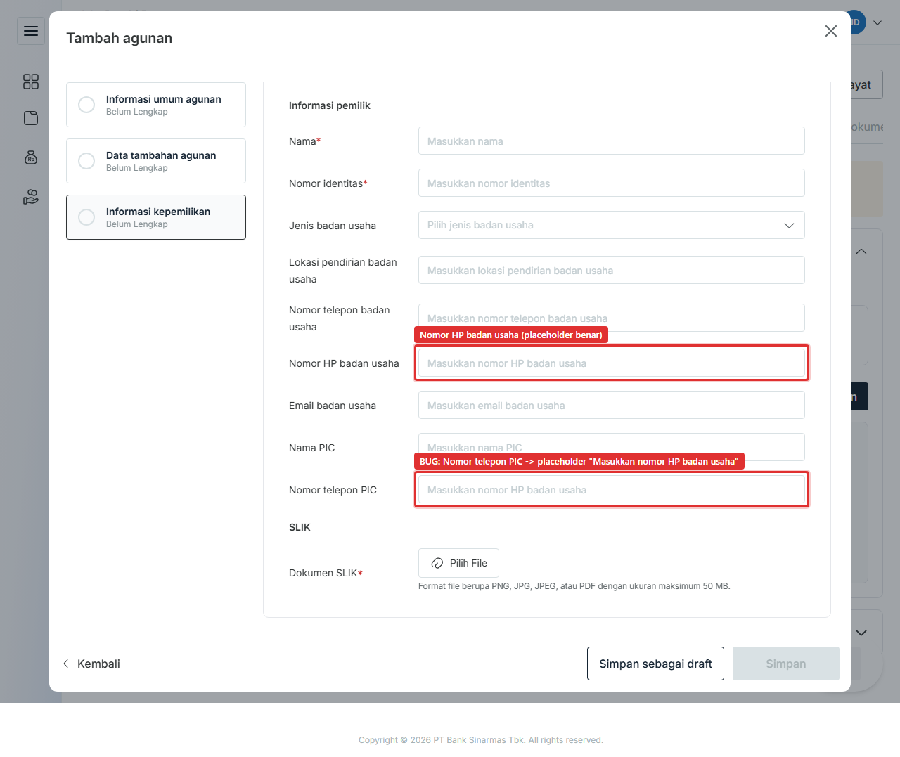
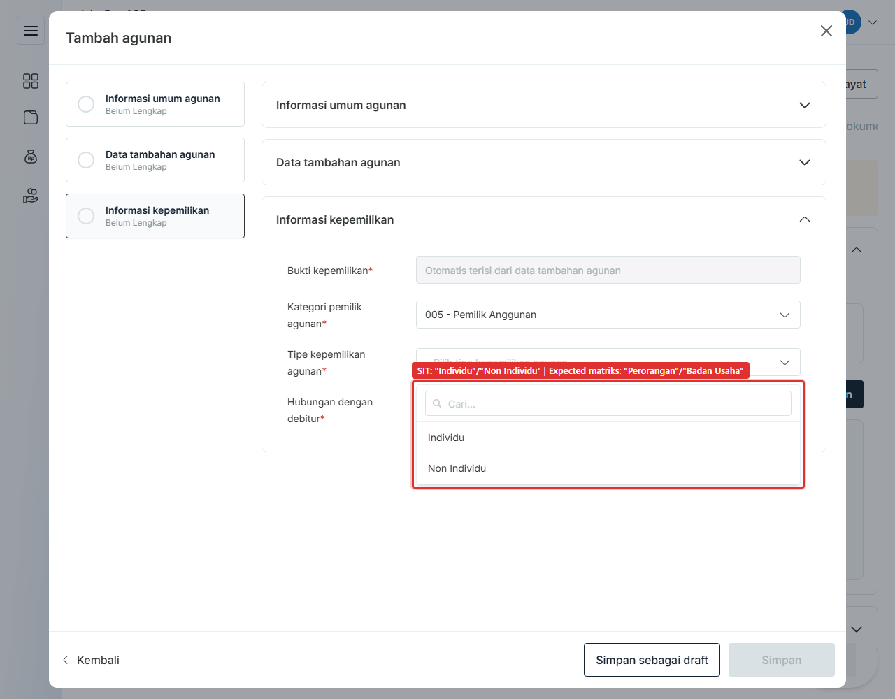

# Laporan Bug & Mismatch Desain — Bucket Agunan, Step 3 Informasi Kepemilikan (S2CML-4949)

**Tanggal pengujian:** 1 November 2026
**Environment:** LAMOS Core Loan SIT — `https://los-fe-coreloan-sit.devs.banksinarmas.com/`
**Story terkait:** S2CML-4949
**Application ID yang diuji:**
- Perorangan: `01M4F7TNSCSHEDB5G3WTSP7HDY` (`debtorType=individual`)
- Badan Usaha: `01M482PRSVH5ZMTVZX5QH0VDNZ` (`debtorType=business`)

**Cara reproduksi eviden:**
```bash
npx playwright test tests/bucketAgunan/_umum/eviden-bug-report.spec.ts --project=chromium
```
Screenshot dihasilkan otomatis oleh suite tersebut dan tersimpan di folder ini (`tests/bucketAgunan/S2CML-4949/bug/`).

> Laporan ini dipecah per story dari `LAPORAN_BUG_Bucket_Agunan_2026-11-01.md` (memuat S2CML-4948, S2CML-4949); temuan story lain ada di folder story masing-masing.

---

## Ringkasan

| No | Layer | Judul | Score | Parent Story |
|---|---|---|---|---|
| BUG-01 | **FE** | Placeholder field "Nomor telepon PIC" salah (duplikasi field lain) | 1 | S2CML-4949 |
| MISMATCH-03 | **BE** | Tipe Kepemilikan Agunan memakai master data `JENIS_DEBITUR` | 3 | S2CML-4949 |

### Cara layer ditentukan

Seluruh response API ditangkap selama interaksi, lalu dibandingkan dengan apa yang dirender FE:
- **BE mengirim data, FE tidak menampilkan** → defect FE
- **BE tidak mengirim data sama sekali** → defect BE

Spec penelusuran: `tests/bucketAgunan/_umum/explore-fe-vs-be.spec.ts` dan `tests/bucketAgunan/_umum/explore-placeholder-source.spec.ts`.

> **Koreksi atas versi awal laporan ini**: ketiga MISMATCH semula ditulis sebagai "mungkin matriks yang perlu diperbarui". Setelah diverifikasi ke **Acceptance Criteria Jira** (bukan hanya matriks test case), ketiganya bertentangan dengan AC — jadi ketiganya adalah defect yang sah. Lihat kutipan AC pada tiap bagian di bawah.

---

## BUG-01 — [FE] Placeholder field "Nomor telepon PIC" tertulis "Masukkan nomor HP badan usaha"

**Layer:** Frontend
**Defect Score:** 1 (kosmetik, tidak memblokir alur)
**Parent story:** S2CML-4949
**Modul:** Step 3 → Informasi kepemilikan → Form SLIK tipe Non Individu

### Langkah reproduksi
1. Buka modal **Tambah agunan** pada debitur perorangan `01M4F7TNSCSHEDB5G3WTSP7HDY`.
2. Masuk ke Step 3 **Informasi kepemilikan**.
3. Pilih Kategori pemilik agunan = **005 - Pemilik Anggunan**.
4. Pilih Tipe kepemilikan agunan = **Non Individu**.
5. Gulir ke bawah hingga field **Nomor telepon PIC**.

### Expected
Placeholder field "Nomor telepon PIC" berbunyi `Masukkan nomor telepon PIC`.

### Actual
Placeholder berbunyi `Masukkan nomor HP badan usaha` — identik dengan placeholder field **Nomor HP badan usaha** yang berada 3 baris di atasnya.

### Eviden


Kedua field tertandai kotak merah agar duplikasinya terlihat berdampingan.

### Data pendukung
Urutan placeholder yang terbaca dari DOM (`input:visible`):
```json
["Otomatis terisi dari data tambahan agunan","Masukkan nama","Masukkan nomor identitas",
 "Masukkan lokasi pendirian badan usaha","Masukkan nomor telepon badan usaha",
 "Masukkan nomor HP badan usaha","Masukkan email badan usaha","Masukkan nama PIC",
 "Masukkan nomor HP badan usaha"]
```
Entri terakhir adalah field Nomor telepon PIC.

### Layer penyebab: FRONTEND
Nol response API memuat string placeholder tersebut — string-nya hardcode di bundle FE `/_next/static/chunks/5970-28b82b8013712c73.js`:

```js
{id:"ownership-pic-phone", name:"ownership.picPhoneNumber", label:"Nomor telepon PIC",
 labelPosition:"left", placeholder:"Masukkan nomor HP badan usaha", isPhoneNumber:!0}
```

Field name dan label sudah benar — hanya nilai `placeholder` yang ter-copy dari field di atasnya. Perbaikan cukup satu string di komponen form, tanpa perubahan BE.

### Dampak
Pengguna dapat salah mengisi nomor HP badan usaha ke kolom PIC. Tidak memblokir penyimpanan karena field ini opsional (tanpa tanda `*`).

---

## MISMATCH-03 — Label tipe kepemilikan `Individu`/`Non Individu`, bukan `Perorangan`/`Badan Usaha`

**Severity:** Low
**Tipe:** Mismatch desain vs build — UI text
**TC terkait:** `TC-4949-03`

### Langkah reproduksi
1. Buka modal **Tambah agunan** pada debitur perorangan `01M4F7TNSCSHEDB5G3WTSP7HDY`.
2. Masuk ke Step 3 **Informasi kepemilikan**.
3. Pilih Kategori pemilik agunan = **005 - Pemilik Anggunan**.
4. Buka dropdown **Tipe kepemilikan agunan**.

### Expected (per matriks)
Dua opsi: **`Perorangan`** dan **`Badan Usaha`**.

### Actual
Dua opsi: **`Individu`** dan **`Non Individu`**. Jumlah opsi sudah benar (tepat 2), hanya labelnya berbeda.

### Eviden


### Catatan untuk BA
Perlu keselarasan istilah. `Individu`/`Non Individu` adalah terminologi SLIK/OJK, sedangkan `Perorangan`/`Badan Usaha` adalah terminologi yang dipakai di bucket lain pada aplikasi ini. Rekomendasi: samakan dengan bucket Identitas agar konsisten.

---

## Lampiran — Berkas eviden

| Berkas | Isi |
|---|---|
| `BUG-01-placeholder-pic.png` | Duplikasi placeholder Nomor telepon PIC |
| `MISMATCH-03-label-tipe-kepemilikan.png` | Opsi tipe kepemilikan |

Spec penghasil eviden: `tests/bucketAgunan/_umum/eviden-bug-report.spec.ts`
Helper penanda kotak merah: `tests/bucketAgunan/_shared/eviden.ts`
